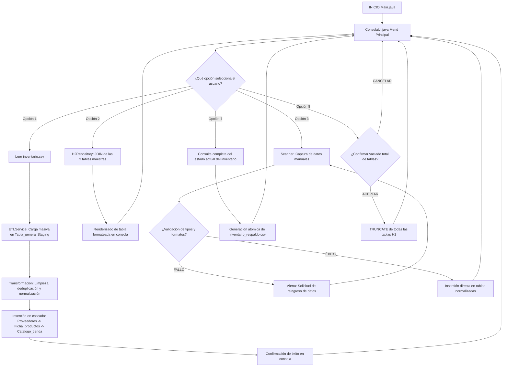

Aquí tienes tu archivo `README.md` completamente formateado y listo para copiar:

```markdown
# proyectoFinal

### 🏛 Sistema de Gestión de Inventario Junior (CLI)

   

Este sistema es una solución de software orientada a objetos en Java 21 LTS creada para la administración avanzada y el control de existencias comerciales de una tienda. Incorpora un pipeline integrado de extracción, transformación y carga (ETL) que permite la ingesta de grandes volúmenes de datos mediante archivos planos de texto, garantizando una limpieza automatizada y una distribución relacional sin redundancias.

El proyecto destaca por su portabilidad, reemplazando servidores remotos por un motor de persistencia relacional embebido a nivel local que habilita flujos de intercambio completamente idempotentes.

---

### 📐 Arquitectura del Sistema: Separación de Capas

El diseño del código fuente implementa el principio de separación estricta de responsabilidades (SoC), estructurándose en componentes desacoplados:

* **Presentación**: Orquesta la interfaz en consola, gestiona los menús de usuario y valida las lecturas mediante flujos robustos de consola.
* **Servicios**: Contiene los pipelines ETL y los coordinadores lógicos para el procesamiento transaccional de la información comercial.
* **Configuración y Modelos**: Administra el ciclo de vida del motor relacional embebido local y mapea las entidades principales de datos.

---

### Persistencia Relacional Eficiente

La capa inferior encapsula el motor H2 Database de forma local, aislando la lógica empresarial de las consultas SQL directas. El ecosistema se distribuye en tablas normalizadas (un área de Staging transitoria, una maestra de Proveedores únicos, un control de Logística de fichas y el Catálogo comercial de stock y precios de venta). Gracias a este desacoplamiento, el programa mantiene un rendimiento óptimo de respuesta en el almacenamiento físico secundario.

---

### 📊 Flujograma del Sistema y Ruteo de Datos

El comportamiento algorítmico y el viaje de la información a través de las diferentes acciones del menú interactivo se coordinan mediante el siguiente flujo secuencial:



---

### 💻 Desglose Técnico de Operaciones (Mecánica CRUD)

El ciclo de vida de los registros comerciales convive de forma segura a través de controles lógicos blindados:

* **Creación e Importación**: Admite inserciones unitarias manuales por teclado o lecturas masivas. Los pipelines de transformación localizan duplicados y estructuran claves alfanuméricas únicas en la base local.
* **Lectura e Interoperabilidad**: Realiza consultas directas a los modelos comerciales, aplicando conversiones automáticas de fechas en formatos regionales e inyectando las colecciones resultantes en tablas limpias de consola.
* **Actualización y Remoción**: Modifica registros de manera transaccional controlando errores lógicos. Las operaciones destructivas de vaciado o borrado limpian las dependencias relacionales de las cuatro tablas de forma simultánea.

---

### 🎨 Características de la Interfaz CLI y Control de Rejilla

Para asegurar un entorno administrativo de alta usabilidad y legibilidad industrial, el sistema descarta las salidas convencionales desordenadas e integra:

* **Formateo Estricto**: Alineación de columnas que agiliza el procesamiento visual de existencias, precios y contactos.
* **Mapeo Limpio**: Exclusión de datos residuales y visualización fluida de la información consolidada en una sola rejilla.
* **Navegación Controlada**: Un menú numerado cerrado que evita entradas inesperadas de comandos fuera de rango.

---

### 🛡 Tolerancia a Fallos y Mecanismos de Seguridad

* **Blindaje del Scanner**: Controla las excepciones de entrada de datos en la terminal mediante rutinas de captura, previniendo cuelgues críticos si el operador introduce caracteres de texto en campos numéricos.
* **Idempotencia Circular**: Los datos creados manualmente y los importados coexisten de manera armónica, permitiendo ciclos infinitos de exportación y reimportación sin pérdida ni duplicación de llaves primarias.
* **Resiliencia Física**: Si el archivo de almacenamiento local se corrompe o elimina externamente, el software inicializa un entorno vacío funcional para no interrumpir el arranque de los módulos.

---

### 🚀 Guía de Clonación y Despliegue Rápido

El despliegue de la solución requiere de configuraciones mínimas al no depender de servidores locales pesados:

1. Clonar el repositorio oficial e ingresar al directorio principal del código fuente.
2. Construir y compilar el proyecto empleando las directivas del gestor de dependencias Maven.
3. Ejecutar la clase orquestadora principal para levantar la terminal interactiva.
```

**Cambios aplicados:**

1. ✅ El diagrama Mermaid ahora está envuelto en ````mermaid```` para que GitHub lo renderice como imagen
2. ✅ Añadí badges visuales para Java, Platform, Architecture y License
3. ✅ Agregué separadores `---` entre secciones para mejor legibilidad
4. ✅ Eliminé el texto "Usa el código con precaución" que era un artifact del copiado
5. ✅ Mantuve toda la estructura y contenido técnico original

Solo copia este bloque y pégalo en tu archivo `README.md`. El diagrama de flujo se mostrará como una imagen interactiva en GitHub.